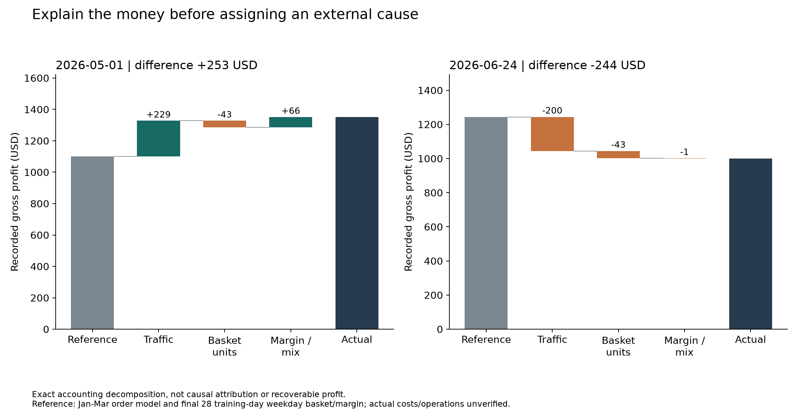
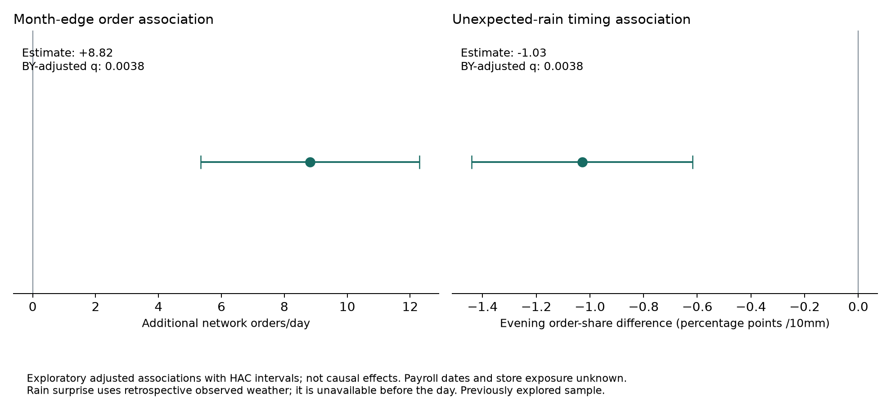

# External-context demand intelligence and the daily evidence ledger

## Correct task

Explain and predict Stories' own sales using a much broader external context. Train/test SALES remain Stories transactions. Outside weather, calendars and other signals may be predictors. The earlier ban on external features was an assistant misunderstanding, not the user's requirement. The old transaction-only model is a useful control and remains unchanged for comparison.

The question for every date is: **what changed financially, which external mechanism is compatible with the timing and menu pattern, what contradicts it, and what decision could be tested?** A plausible event alone cannot establish the actual cause. Every day receives a record, including unresolved days.

## Implemented extension

- Nine cached source streams: ERA5 hourly weather, ECMWF 24-hour-lead forecasts and CAMS air-quality context, each for Beirut, Batroun and Broummana scenarios. All 4,752 hourly records per stream are complete for the extended window; caches cover Dec 15-Jun 30 to form antecedent features. Six monthly IODA downloads supply 4,344 unique hourly national reachability aggregates separately.
- **73 daily context columns**, 181 dates x3 geography scenarios =543 rows. No region is assigned to an anonymized branch.
- **2,310 core exploratory association rows**, plus 27 internet hypotheses. Across the union of **2,337 rows**, 2,277 support the defined statistical screen; **41 rows pass global BH and 11 pass global BY**. These are correlated rows, not 41 independent causes. Some regional series share the same native weather grid.
- Separate order-traffic, category-volume and product-mix model comparisons, fitted on Jan-Mar with training-only selection. April-June remains a previously explored chronological test.
- **724 reconciled daily dossiers:** all 181 dates, network plus Garden/Harbour/Uptown. Includes sources, counterchecks, uncertainty/status, possible actions and unexplained demand.
- **23 tests pass**, including target isolation, source-stream separation, fasting exceptions, missing-sample handling and exact accounting/model reconciliation. Independent verification also reconciles 49,140 item/day/method predictions and every dossier.

Implementation source, trained artifacts, cached external inputs and generated audit outputs are committed to GitHub. A clone can run these scripts without retrieving fresh external data. `python src/verify_submission.py` checks the complete implementation; the current suite has 39 tests plus four artifact-verification scripts.

## Mechanisms beyond generic weather/holiday labels

| Mechanism | What would distinguish it | Implementation/status |
|---|---|---|
| Ramadan sunset clock | Two-hour sales windows before/after actual sunset, not a fixed18:00 boundary | Tested; does not establish a universal Ramadan effect |
| Maronite noon clock | Morning vs afternoon behavior; calendar exceptions and Holy Week matter | Calendar sourced; tested separately from Ramadan |
| Overlapping fasting calendars | Menu substitution while Ramadan, Maronite Lent and Orthodox Lent overlap | Meat/tuna finding below; one overlapping episode |
| Friday/feast exceptions | Abstinence calendar differs from simply labeling every Friday alike | Tested with specified exceptions; observance unknown |
| Apostles abstinence in June | A different Christian fasting window after Easter | Calendar source found; one short episode is descriptive only |
| Thermal novelty | Feels-like temperature relative to preceding7 days, not just absolute temperature | Tested |
| Humid heat | Apparent temperature/humidity instead of daily maximum alone | Tested |
| Rain at buying times | Morning, afternoon and evening rainfall can move orders rather than destroy them | Tested |
| First rain after a dry spell | Weather change may matter more than a rainy-day dummy | Tested |
| Next-day catch-up | Demand may be delayed rather than permanently lost | Tested with lagged rainfall; not established causally |
| Forecast surprise | Unexpected rain versus archived prior prediction may alter the late-day mix | Strong exploratory timing association; retrospective, not pre-opening information |
| Dust/PM/haze | Outdoor discomfort or dine-in/takeaway changes without a temperature change | CAMS model-based exposure tested; not a ground monitor |
| Rain after dusty air | Rain and antecedent dust may jointly change activity | Exploratory geography-sensitive timing association |
| Coast/mountain comfort gap | Weekend destination substitution, not one national weather coefficient | Scenario sensitivity; native-grid/elevation limitations |
| Monthly liquidity cycle | Order frequency may change at month edges | Repeated monthly association; actual salary dates unverified |
| Bridge days | Adjacent holiday/weekend patterns may differ from the holiday itself | Tested; cafe hours unknown |
| School attendance mode | Morning routines can change after remote-learning announcements | Official announcement sourced; short transition window is descriptive |
| Displacement inflow vs outflow | Receiving and origin areas can move in opposite directions | IOM sources identified; data access403 and branch mapping absent; NOT joined as invented daily counts |
| Public events vs road obstruction | The same race may attract customers near the route and block access elsewhere | Existing sourced event dossiers; exposure unresolved |
| Graduation clock | Event-time evening demand should differ from morning demand | Existing AUB/Haigazian sources; geographic exposure unverified |
| Internet/POS measurement failure | A fall in recorded transactions may reflect capture/connectivity, not demand | IODA national reachability retrieved and audited; two Harbour associations pass global BH, none pass BY; no store outage inferred |
| Competitor/app/paid-campaign shocks | Channel-specific changes and competitor catchments | Unobserved; not invented from unexplained residuals |
| Generator/utility/supplier disruption | Store-hour, production-capacity or ingredient-cost changes | Operational logs required; not a measured external correlation |
| Basket and product-margin mix | More orders can coexist with smaller baskets or less profitable items | Exact daily financial bridge implemented |

Primary sources: [Bkerki's2026 guidance](https://bkerki.org/news-article/%D8%A7%D9%84%D8%B5%D9%88%D9%85-%D8%A7%D9%84%D9%83%D8%A8%D9%8A%D8%B1-%D8%B5%D9%84%D8%A7%D8%A9-%D9%88%D8%B5%D8%AF%D9%82%D8%A9-%D9%88%D8%B5%D9%8A%D8%A7%D9%85-%D8%B1%D8%B3%D8%A7%D9%84/), [Orthodox calendar](https://www.goarch.org/chapel/paschalion), [Open-Meteo historical weather](https://open-meteo.com/en/docs/historical-weather-api), [previous-run forecasts](https://open-meteo.com/en/docs/previous-runs-api), [CAMS air context](https://open-meteo.com/en/docs/air-quality-api), [IOM displacement](https://dtm.iom.int/lebanon), [IODA public API](https://api.ioda.inetintel.cc.gatech.edu/v2/). Exact school-announcement URLs and source notes are in `data/external/context_v2/feature_catalog.json`; earlier event URLs remain in `data/external/outlier_event_registry.json`.

## New findings and what they can support

### Month edges: traffic, not proven salaries

The first/last three dates of each month have approximately **8.82 more adjusted network orders/day** than other dates, conditional on weekday, trend, holidays, conflict and the recorded promotion window. Approximate HAC interval is5.34-12.30 orders, BH q0.00046, BY q0.00380. There are36 exposed dates across six months.

The direction stays positive when any month is removed. But future-shifted calendar controls also show structure, and actual payment dates/customer exposure are absent. Call this a **month-position association**, not a proven payday effect.

Decision: test whether stock/staff review around month edges improves service and contribution. The traffic forecasting head tests this association prospectively within the historical split; measured company ROI is still absent.

### Rain surprise: when people buy may matter more than total volume

For the Beirut proxy,10mm more observed rain relative to the archived prior forecast corresponds to about **1.03 percentage points less evening order share** after controls. BH q0.00046, BY q0.00380. Direction survives omitting each month; a seven-day future-weather control is weak for this outcome.

This is a retrospective timing association. Reanalysis rain is unavailable before the day and is not the same as an actual branch rain gauge. A useful next prediction test is whether observations available by16:00 predict the later batch, with real lead times and source vintages.

The apparently positive hot-coffee association with rain surprise has a strong future-weather negative control, so it is **not treated as a trustworthy explanatory mechanism**.

### Fasting overlap: investigate substitution, not customer religion

During Feb23-Mar19, the adjusted meat-to-tuna log ratio is lower: the specified smoothed log-ratio model has BH q0.00683, but BY q0.05669, so it misses the conservative5% threshold. Alternative pseudocounts and a binomial count model retain the direction. The effect is still an exploratory, post-selection association from one overlapping calendar episode with conflict confounding. Removing February eliminates the identifiable comparison; that missing estimate is not robustness evidence.

This supports a **menu-mix pilot hypothesis**: compare meat/fish preparation and margins around future fasting calendars. It does not identify customers' faith, prove observance or justify labeling Harbour/Garden/Uptown Christian/Muslim.

### Connectivity: distinguish customer demand from transaction capture

IODA national active probing provides a separate way to challenge a sales explanation. Harbour units are associated with national reachability level and minimum-drop proxy; global BH q values are approximately 0.042 and 0.024, but BY q values are 0.352 and 0.199. These are exploratory leads, not strong evidence of a store outage. The underlying measure counts reachable probed network blocks, not customers or POS terminals. [IODA's public API](https://api.ioda.inetintel.cc.gatech.edu/v2/) provides the source.

Action: compare POS offline receipts, payment/network logs and delayed synchronization with flagged dates before diagnosing lost demand or launching a promotion. Missing samples remain missing; coverage is audited separately. All 181 dates have at least 90% local-hour coverage, with Jan 1 missing the two hours before UTC retrieval begins. The API provides hourly aggregates of finer probing observations, not independent customer counts. These signals are retrospective context, not issued day-ahead forecasts.

### Important geographic countercheck

The requested Beirut and Broummana ERA5/IFS weather series resolve to the same native grid coordinate (33.75,35.5). Their identical rainfall effects are **not independent replication**. Elevation adjustment can change temperatures without creating a separate local rain measurement. Batroun uses another grid. True branch coordinates and appropriate spatial resolution remain necessary.

## What changed in the model

The extension uses specialists rather than forcing every external factor into one sales equation:

1. **Internal volume control:** the trained pooled Poisson category model.
2. **Traffic head:** external calendar/weather specialists predict Stories order counts; choose family and penalty using March11-31 training validation.
3. **Item-mix head:** category-specific multinomial models redistribute a fixed category volume. Each category can retain internal history or select calendar/issued-weather features. A matched internal mix model prevents attributing ordinary pooling improvements to external data.
4. **Preparation optimizer:** converts quantities and costs into opening/replenishment decisions and service/cost tradeoffs.
5. **Evidence ledger:** keeps exact accounting, model adjustments and external causal hypotheses distinct.

Traffic test WAPE improves from **9.4644% to 9.2658%** with the training-selected month-cycle specialist. This is a modest improvement, not a breakthrough ROI claim. Broad calendar/disruption models overfit and do worse; they are retained as failed comparisons.

For daily category units, the selected external specialist gives25.2262% WAPE versus25.2077% internal: **no aggregate-volume gain**. The context model therefore does not justify claiming external effects explain all daily fluctuations.

The predictive item-mix selector improves all-item WAPE from 53.2678% to 52.6710%; the matched internal mix control is52.6956%. Most improvement comes from better internal pooling. Eight categories select an internal branch model; Matcha & Tea selects a weather expert. Perishable contribution is **$10,817.66**, versus the original control's **$10,934.29**, at 92.14% vs 92.09% fulfillment. A training-profit-selected experimental mix earns $10,560.98 and fails to find a90%-fulfilled validation candidate in Breakfast/Desserts. Neither new mix policy is declared a superior operating policy. Keep the original planner as the financial reference.

Observed-weather/air models are explicitly oracle/explanatory diagnostics. They are never described as pre-opening forecasts. All external model targets remain Stories transactions; no other retailer's sales are involved.

## Every date has an evidence dossier

```bash
python src/explain_day.py --date 2026-06-24 --branch "All branches"
python src/explain_day.py --date 2026-05-01 --branch Harbour
```

Each dossier contains actual orders/units/revenue/recorded gross profit, expected orders, a frozen training-period basket/margin reference, an exact financial bridge, externally conditioned traffic prediction, unit forecast, model-adjustment groups, unexplained remainder, observed/issued context, regional sensitivity, source-linked mechanisms and counterchecks/actions.

The **financial bridge** uses a symmetric three-factor Shapley accounting decomposition:

```text
Recorded gross profit = orders × units per order × recorded margin per unit
Change versus reference = traffic contribution + basket contribution + margin/mix contribution
```

This is an exact accounting identity, not causal attribution. The reference order model is trained Jan-Mar and basket/margin reference uses the final 28 training dates; Jan-Mar dossiers are retrospective fits and flagged as such.

For **June24, network gross profit is $243.62 below that reference**: traffic accounts for-$200.22, basket units-$42.52 and margin/mix-$0.88. The same date has verified displacement-related waterfront reporting, but branch exposure is unknown. The arithmetic identifies the business lever; the event is a candidate explanation, not a proved cause or recoverable amount.

For **May1, the gap is+$252.54**: traffic+$228.84, basket-$42.75, margin/mix+$66.44. More orders did not imply bigger baskets. The Labour Day explanation still needs repeated/exposed comparisons.





## Reproduction and team work

```bash
python src/fetch_context_v2.py
python src/fetch_internet_context.py
python src/context_features.py
python src/context_associations.py
python src/internet_checks.py
python src/context_robustness.py
python src/context_model.py
python src/context_model.py --target orders
python src/context_mix_model.py
python src/day_explanations.py
python src/explain_day.py --date 2026-06-24
python src/context_visuals.py
python src/verify_context_artifacts.py
python -m unittest discover -s tests -v
```

The old strict model/artifact must exist first (`python src/strict_model.py`). Cached context permits offline reproduction of numerical analysis. Internet retrieval uses normal verified HTTPS; a Windows trusted-root fallback handles the server chain where needed, without disabling TLS checks. `reports/context_v2_manifest.json` records hashes, versions and reconciliation checks.

The latest teammate event list and notebook 09 were pulled through `fd88316`. [Source reconciliation](reports/source_reconciliation.md) provides primary ISF/PCM URLs for entries still labeled not_found/unsourced in that list. The daily ledger incorporates sourced teammate candidates without upgrading their verification or branch-exposure status. The earlier May 1 anomaly is method-sensitive: it passes the rolling screen but not notebook 09, so it remains a lead.

Teammate2's offline demo, pilot log, metric reconciliation and independent factor tests were then pulled through `50beb80`. The app is already built at `app/planner.html`; the remaining UI task is to integrate the new daily ledger/traffic fields, not recreate it. Preserve its pilot-log schema and generated JavaScript contracts. The independent factor test has zero of 33 passes under its two-direction/Holm criterion; that is compatible with exploratory associations under other outcome definitions. The 9.46%-to-9.27% traffic comparison is a modest forward test result, not a claim to have passed that different criterion. The arrival-noise benchmark in the teammate driver report depends on Poisson assumptions and is not an absolute ceiling on all external information.

- **Codex:** models, financial bridge, tests and evaluation; publish implementation separately from the ongoing Markdown updates.
- **Omar:** confirm branch mapping, event dates/availability, store hours and exposure; maintain sources and counterexamples.
- **Interface teammate:** extend the existing offline app with a day selector, traffic/basket/margin waterfall, weather/forecast comparison, menu timing, source/evidence status and unexplained demand. Keep historical and live/scenario labels visible and preserve the pilot log contract.

The next business validation is a prospective company pilot using actual preparation, waste, stockouts, labor and verified branch conditions. Further model choices must not be selected by repeatedly searching April-June test outcomes. New associations and models here were designed after the dataset had been explored; all are exploratory.
