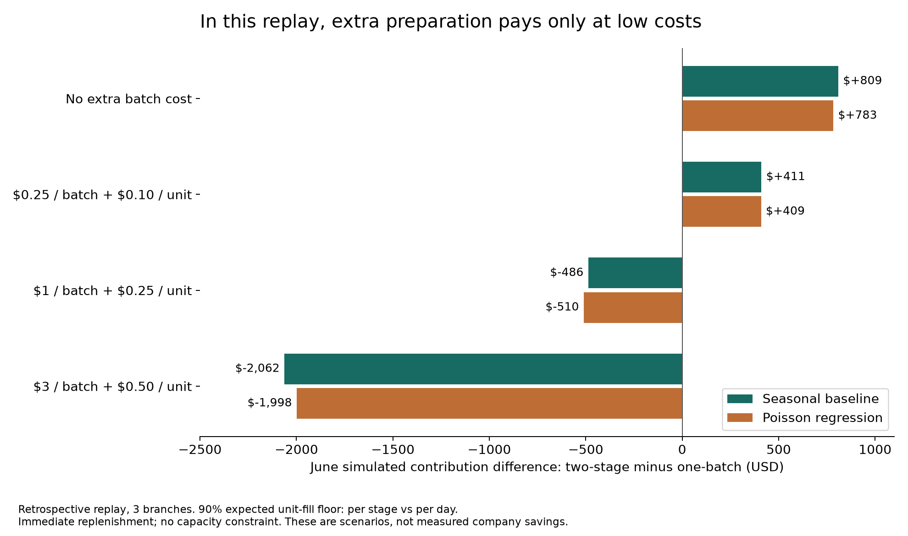
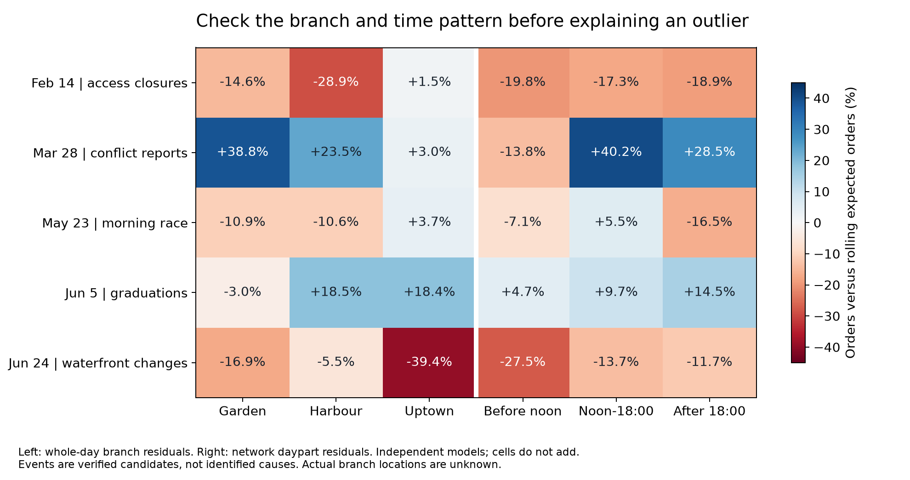

# Stories Profit Planner | EECE490 Hackathon

**A working sales and preparation decision system for Stories Coffee.** Basket Growth recommends relevant add-ons, Wejha Lab compares product-display arrangements, and the preparation model turns demand into opening batches and replenishment actions. The display experiment separates paired products so customers may encounter more of the counter; placement-induced sales growth still requires a pilot. Source code, trained artifacts and generated offline demo data are committed. [Submission quickstart](SUBMISSION.md), [shared team contract](WEJHA_BUILD_PLAN.md).

| Start immediately | Owner | Deliverable and status |
|---|---|---|
| Model and backend | Codex teammate | **Implemented and published:** frozen basket recommender, five candidate comparisons, offer/preparation integration, external-context models, constrained layout optimizer and generated comparisons; all 38 tests pass. |
| Offline interface | Claude Code teammate 2 / Marwa | New `app/wejha.html`, linked from the existing planner. Load `window.STORIES_RECOMMENDATIONS` and `window.STORIES_WEJHA`; contracts are in the build plan. Own these UI files. |
| Business validation and experiment | Claude Code teammate 1 / Omar | New `WEJHA_PILOT.md`, separate `data/pilot/basket_pilot_template.csv`, and `reports/wejha_business_review.md`. Check browsing/service feasibility, pair evidence, margin assumptions and controlled profit measurement. Own these files. |

**Sync rule:** the latest user instruction authorizes ongoing pushes of code, generated artifacts and documentation. Each owner pulls safely, preserves others' work and pushes usable milestones. Planned filenames are not evidence of a completed implementation. Existing preparation cards, pilot schemas, baseline results and the newly pulled Day Explorer remain supported.

**Run the integrated demo:** open [`app/wejha.html`](app/wejha.html) in a browser for basket recommendations, availability controls, three display arrangements and an editable incremental-profit scenario. [`app/planner.html`](app/planner.html) links to it and retains preparation planning and the every-day diagnostic. Both pages work offline with the committed generated scripts.

**Offer → stock → profit integration is implemented:** `python src/growth_plan.py --branch Harbour --item Espresso --daypart morning --output reports/growth_demo.json` produces complementary food offers, the frozen preparation plan for each food item, an explicit zero-default incremental-profit scenario, and a separately labeled retrospective daily diagnostic. It loads committed artifacts and adds no invented offer uplift to demand. `python src/growth_plan.py --export-preparation` produces 57 historical perishable cards in `app/preparation_data.js`. [Integration contract and optional UI additions](GROWTH_INTEGRATION.md). **38 total tests pass.** The complementary filter is a business rule; the evaluation numbers below belong to unrestricted ranking.

```bash
pip install -r requirements.txt
python src/verify_submission.py
python src/basket_recommender.py recommend --branch Harbour --item "Butter Croissant" --daypart morning
python src/basket_recommender.py train
python src/wejha_layout.py
python -m unittest discover -s tests -v
```

**Trained recommendation model:** empirical-Bayes shrinkage of conditional item co-purchases toward pooled popularity, with branch/daypart/aggregate regular-customer contexts and unit-margin ranking. March validation selects strength 500; all parameters/economics freeze on March 31. In **8,801 April–June multi-product orders**, the recovered-item margin@3 proxy is **$0.5080/order versus $0.4956** for margin-weighted popularity, a **2.51% relative gain**. The paired seven-day block interval for the difference is **$0.0028–$0.0251/order**. This metric rewards recovering an item that was already bought; it is **not additional sales or company profit**. Hit@3 is **13.29%**, versus **12.90%** for the margin baseline and **13.74%** for plain popularity. [Full evaluation](reports/recommendation_evaluation.md), [generated results and cohort denominators](reports/recommendation_results.json).

**Wejha Lab:** exact enumeration of all arrangements of eight bakery candidates compares adjacent, separated and random-reference layouts. Weighted pair distance is **0.373 / 0.511 / 0.425** respectively. These are geometric exposure scores; higher distance is the user's testable mechanism, not proven sales uplift. Fixed positions and compatible storage zones are supported through a constraints JSON. Real counter dimensions, current placement and customer paths are unobserved. [Layouts and assumptions](reports/wejha_layouts.json). The frozen six-training-date regular cohort accounts for **3.10% of test revenue**; this specific definition does not support the premise that most revenue comes from loyal customers.

**Data scope:** outside weather, calendar, access and other context are allowed as features. Training and test **sales targets remain Stories' own sales**. The transaction-only model below is the control. See [EXTERNAL_CONTEXT.md](EXTERNAL_CONTEXT.md) for expanded research, external models and the every-day evidence ledger.

The published external-context implementation includes nine cached hourly weather/forecast/air-quality streams, six months of IODA internet reachability, 73 daily context columns plus the separate internet audit, **2,337 exploratory test rows** and **724 day/branch dossiers covering all 181 dates**. A separate externally conditioned order-count head improves test WAPE from **9.46% to 9.27%**; daily product-volume gains are not established, and improved item forecast error did not improve simulated profit. No external sales dataset is used. [Source reconciliation](reports/source_reconciliation.md) supplies primary URLs missing from the teammate event registry.

Analysis of January-June 2026 transactions from three anonymized branches: Harbour, Garden and Uptown. The goal is to identify decisions that improve gross profit, validate external demand signals, and distinguish measured results from business assumptions.

**Published implementation:** demand, inventory, external-context, recommendation and layout code, saved models, browser assets and numerical audits are in the repository. `python src/verify_submission.py` runs all 38 tests and four artifact-verification scripts. Browser script/schema/ranking checks are recorded in `reports/ui_contract_qa.json`; a visual browser review was unavailable in the Codex session. The **frozen chronological half/half transaction-only model** remains the control, and earlier rolling/Bayesian comparisons remain separate experiments. [Evaluation protocols](EVALUATION.md), [model card](MODEL_CARD.md).

## Transaction-only control: chronological half/half

The model is an **L2-regularized pooled Poisson regression**, followed by item allocation and a profit-aware preparation rule. It learns branch/category demand, weekday patterns and growth using only `stories_transactions.csv`. It uses no weather, holiday, war, news or external data files as model inputs.

- **Training:** Jan 1-Mar 31, 90 dates and 22,395 product lines.
- **Testing:** Apr 1-Jun 30, 91 dates and 28,782 product lines.
- **Selection:** the last 21 training dates select regularization; the selected alpha is 0.001. Refit on the 90 training dates, then freeze everything.
- **Strict boundary:** the whole test period is forecast at March 31. No test sales lags, refits, item shares, prices, costs or intraday splits enter the model. Half means half of the daily timeline, keeping complete dates/orders together; growing transaction volume makes row counts unequal.

| Frozen model, April-June test | Category WAPE | Perishable item WAPE | Simulated contribution | Actual recorded units fulfilled |
|---|---:|---:|---:|---:|
| **Improved model (v2, selected on inner validation)** | **24.74%** | **51.57%** | **$11,944.21** | **90.92%** |
| Trained Poisson model (original) | 25.21% | 52.03% | $10,934.29 | 92.09% |
| Seasonal baseline with training-only growth | 26.64% | 53.58% | $9,915.15 | 92.19% |
| Frozen four-weekday baseline | 28.22% | 53.75% | $13,409.52 | 88.22% |

**v2 (teammate 1):** the same engine and alpha, plus two changes chosen only on the last 21 training dates: (1) a level calibration factor of 0.942 (inner-validation actual ÷ predicted, correcting a +6.2% over-forecast) and (2) item shares from all 90 training dates with smoothing 10 instead of the last 28 days with smoothing 1 (best of 20 window/smoothing settings on inner-validation item deviance). On April-June it improves category WAPE (25.21% → 24.74%), all-item WAPE (53.27% → 52.09%) and perishable WAPE (52.03% → 51.57%), and adds **$1,009.92** simulated contribution versus the original model (7-day block interval about $884-$1,126) with 528 fewer unsold units, while realized fulfillment stays above 90% (90.92%). The artifact now selects v2; the original rows are kept for comparison. Upgrades to the category engine itself (branch × category × weekday terms, per-series trends, recency weighting) were tried and lost on inner validation, so they are not used. `python src/predict_strict.py` also accepts `--cost-multiplier`, `--price-multiplier` and `--no-discount` to run the ANALYSIS.md cost, price-test and discount scenarios; these hold demand constant and do not estimate customer response.

The original model improves simulated contribution by **$1,019.13 versus the growth baseline**, with 240 fewer unsold units and 13 fewer fulfilled units. The frozen baseline earns more simulated contribution while fulfilling fewer recorded units; selecting it solely for profit would conceal that service tradeoff. All use the same one-batch rule with a 90% **expected** unit-fill constraint, which does not guarantee 90% realized fulfillment. These are conditional inventory simulations, not measured savings or a comparison with Stories' actual operating policy. This dataset had already been explored before the new split was requested; the clean computational boundary does not make it a newly untouched test set.

```bash
pip install -r requirements.txt
python src/strict_model.py
python src/predict_strict.py --date 2026-06-30 --branch Harbour --product "Turkey & Cheese Sandwich" --remaining 0
python -m unittest discover -s tests -v
```

Training saves a reusable artifact at `models/strict_half_model.joblib`; prediction loads that artifact without reading transaction or external data. The example forecasts about **4.04 Turkey & Cheese Sandwiches at Harbour**, prepares **4 at opening**, and prepares **4 more at 16:00 if none remain**, under stated low replenishment costs. This second-batch example is a decision-model scenario; the table above evaluates the simpler one-batch policy. Committed test predictions, finance and metadata are in `reports/strict_half_predictions.csv`, `reports/strict_half_finance.csv` and `reports/strict_half_results.json`.

## Business application and supplemental experiments

**A branch-and-item preparation planner that chooses an opening batch and a second batch at 16:00, prices the extra work, and reports its service and profit tradeoffs.** External-event research supplies evidence-linked review alerts. It changes numerical forecasts only after exposure and predictive value are established.

The implemented decision model is a **two-stage stochastic inventory dynamic program**, using Poisson demand and an expected unit-fill constraint. Its inputs are demand, branch-item selling price and ingredient cost, intraday mix, replenishment cost and salvage. Its output is an opening quantity plus a lookup table: **given remaining stock at 16:00, prepare this many more units**. This is an executable decision, not just a sales correlation.

The forecasting candidates are a regularized pooled Poisson regression and a strong seasonal baseline: the preceding four matching weekdays at branch/category level, allocated to items using prior 28-day shares. The complex forecast wins the original category accuracy comparison but **loses the new service-constrained profit comparison**. The demo defaults to the transparent baseline; this choice is exploratory and needs a future prospective evaluation. We do not claim complexity itself creates value.

### Earlier rolling-planner demo

```bash
pip install -r requirements.txt
python src/recommend.py --branch Harbour --product "Turkey & Cheese Sandwich" --remaining 0
python src/recommend.py --mean 5 --early-share 0.4 --price 6 --cost 2 --setup 1 --premium 0.25
python -m unittest discover -s tests -v
```

The first command reviews a **June 30, 2026 historical decision**, not today's forecast. The second lets the company change business inputs. Output includes opening units, the second-batch table, expected contribution and assumptions. It never uses afternoon sales to choose the afternoon batch. Immediate replenishment and unconstrained capacity are simulation assumptions; production use requires actual lead times and capacity.

### Where the money comes from

June retrospective replay: 1,710 branch-item-days, 57 perishable branch-item combinations, 4,657 recorded units. Both policies use the same forecast, prices and ingredient costs. The 90% numerical expected-fill floor applies to the whole day for one batch, and separately to each stage for two batches; report realized service as well as contribution.

| Scenario, strong seasonal forecast | One-batch contribution | Two-stage contribution | Difference |
|---|---:|---:|---:|
| No incremental replenishment cost | $4,930.92 | $5,740.15 | +$809.24 |
| $0.25 per SKU second batch + $0.10 per extra unit | $4,930.92 | $5,341.65 | **+$410.73** |
| $1 per SKU second batch + $0.25 per extra unit | $4,930.92 | $4,444.43 | **-$486.49** |
| $3 per SKU second batch + $0.50 per extra unit | $4,930.92 | $2,869.24 | -$2,061.68 |

In the low-cost scenario, simulated fulfillment rises from **90.68% to 93.43%**, unsold units fall from **2,859 to 2,763**, and 920 SKU replenishments occur: **10.2 per branch-day**. The remaining gain can cover only **$4.56 additional overhead per branch-day**. A 7-day block resampling interval is approximately $178-$619, conditional on this replay and these assumptions; it does not measure uncertainty in missing costs or demand. The regression forecast earns **$149.17 less** than the seasonal forecast with the same two-stage policy. Separate operational flexibility from AI forecast value.

These are **simulated contribution differences, not measured savings or net profit**. Sales may be censored by unknown stockouts; actual preparation, waste and current company policy are absent. June had already been examined when this policy was developed, so it is **not an untouched confirmation set**. A service floor of zero produces larger contribution but poor fulfillment; it is a stress scenario, not our recommended operating objective. See [complete results and assumptions](reports/two_stage_results.json), [category breakdown](reports/two_stage_by_category.csv) and [all replay decisions](reports/two_stage_replay.csv).



### What deeper external research found

We screened 2,224 rolling day/branch/daypart comparisons, investigated 18 date dossiers and recorded verified events separately from proposed mechanisms. Most eye-catching days do not survive the approximate multiple-testing screen. Only **Harbour on May 1** is flagged: 149 orders versus about 100 expected, approximately +49%, adjusted q = 0.023. A single Labour Day cannot establish a repeatable causal uplift.

| Date | Forecast-adjusted sales fingerprint | External evidence and decision |
|---|---|---|
| Feb 14 | Network orders -18.5%; Harbour -28.9%, Uptown +1.5% | ISF announced downtown road closures. Check branch access before interpreting this as Valentine's demand. Locations are anonymized, so exposure is unresolved. |
| Mar 28 | Network +24.1%; morning -13.8%, midday +40.2% | Conflict reporting does not explain a positive sales day by itself. The clock change starts the following day and cannot explain this daytime spike. |
| May 23 | Network -7.9%; evening -16.5% | A verified morning waterfront race did not yield an automatic network sales increase. Event presence alone is a poor boost rule. |
| June 5 | Network +11.3%; evening +14.5% | AUB's 19:30 graduation is temporally compatible; Haigazian also held graduation. Catchment exposure and incremental demand remain unproven. |
| June 24 | Network -15.4%; morning -27.5%; Uptown -39.4% | Reuters documented displacement-related waterfront changes. This is a candidate mechanism, not a verified cause at an anonymous branch. |

Source URLs, publication/known-at dates and explicit counterchecks are in the [event registry](data/external/outlier_event_registry.json) and [outlier dossiers](reports/outlier_dossiers.json). The [research and pilot specification](reports/deeper_research_and_build_plan.txt) explains additional checks on airport arrivals, exchange rates, fuel, seasons and holidays. Official monthly USD exchange rates are constant in the window; monthly airport arrivals are too coarse and too few to explain individual days. Do not manufacture daily predictors from them.



Across the original external-driver models, calendar and available weather features **did not beat internal history on held-out overall forecast accuracy**. The strongest exploratory product lead is reduced sandwich demand over four Muslim holiday closure episodes, around 4 units/day across the network; four episodes cannot establish a universal religious effect. Annual seasonality is unidentified from January-June. War effects cannot be geographically attributed without the real branch map.

### Exact submission and three-person work split

| Owner | Concrete responsibility | Acceptance condition |
|---|---|---|
| Codex teammate | External-context traffic/volume/mix heads, every-day evidence ledger, transaction-only control, saved artifacts and profit optimizer | Stories-only sales labels; training-only selection; sourced external features; forecast timing, costs and service visible |
| Claude Code teammate 1 (Omar Al-Aghbari) | External evidence and branch exposure; confirm event timing, coordinates and weather provenance | Every usable feature has a source, known-at time, geography and future validation; unresolved events remain alerts |
| Claude Code teammate 2 | Presentation/demo interface and pilot logging using the existing JSON/CSV contracts | Show opening plan, remaining-stock input, replenishment action, cost sensitivity, service and evidence; never present historical cards as live recommendations |

**Implemented and committed:** trained half/half model and saved artifact; forecast baselines; external-context traffic/volume/mix models; every-day dossiers; two-stage optimizer; cost/service scenarios; supplemental intraday Gamma-Poisson/NB comparisons; basket recommender; display optimizer; CLI integration; offline UI and decision data; 38 tests plus artifact/frontend checks. **Still needed for live operation:** verified operational inputs, capacity/lead-time handling and a controlled prospective profit pilot. Full team names must be confirmed before submission; this repository does not establish all three identities.

Start the company pilot with shadow decisions and measured preparation, waste, stockouts and batch labor. Then randomize eligible branch-days within branch and weekday between current practice and the planner, after safety and service rules are agreed. Choose the duration using baseline profit variance and a business-relevant minimum detectable gain; do not claim three branches automatically provide sufficient power. Evaluate incremental contribution after waste and extra labor, customer fulfillment and overrides. Freeze the policy before the pilot. The [build plan](reports/deeper_research_and_build_plan.txt) gives the data contract and demo narrative; [AGENTS.md](AGENTS.md) is the shared work contract for all three contributors.

### Reproduce the analysis

```bash
python src/external_analysis.py
python src/demand_model.py
python src/holiday_robustness.py
python src/outlier_forensics.py
python src/profit_policy.py
python src/decision_visuals.py
python src/verify_decision_artifacts.py
python -m unittest discover -s tests -v
```

External sources are cached and cited. The pipeline does not require querying live news to reproduce numerical results. `src/recommend.py` can use committed decision cards immediately. No automated live forecasting service is claimed to be complete.

### Demo interface and pilot log (Claude Code teammate 2, Marwa)

`app/planner.html` is a single offline page. Open it in a browser; it needs no server or network. It has five tabs. Open `app/planner.html#day` (or `#why`, `#plan`, `#evidence`, `#pilot`) to start on a given tab.

1. **Why:** the driver breakdowns from `src/why_drivers.py` (see "Why the numbers move" below), read from the generated `app/why_data.js`.
2. **Day explorer:** pick any date from Jan 1 to Jun 30 and a branch (or all branches). The tab shows the day's orders against the frozen Jan-Mar model's expectation, with a Poisson z-score. It shows a traffic/basket/margin waterfall: a symmetric 3-factor Shapley split of gross profit against a reference built from expected orders and the Mar 4-31 basket and profit per item, which is accounting, not a cause. It also shows the day's time-of-day mix against the training mix for that weekday, observed weather at the three candidate locations, and events active that day with their verification status, branch exposure and source (from `data/external/external_events.json`, the holiday list and Ramadan). It ends with the ten most unusual days, alongside how many would be expected by chance (7 of 181 network days reach |z| ≥ 2, against about 8 expected). This is the interface task requested in EXTERNAL_CONTEXT.md. The data come from the **interim** `src/day_ledger.py` → `app/day_data.js` (and `reports/day_ledger.csv`), because the Codex daily dossiers are not yet published. Swap in their export once it is available; for June 24 the traffic part agrees closely (−$202 here vs −$200.22 in EXTERNAL_CONTEXT.md). Issued forecasts (the forecast-vs-observed comparison) need the Codex context cache and are not shown yet.
3. **Today's plan:** the decision card's forecast, opening quantity, a remaining-at-16:00 input that returns the top-up quantity, the full lookup table, cost assumptions, event-adjustment status and a permanent "historical replay" banner. Its only built-in cards are the two checked examples quoted in AGENTS.md. Load `reports/decision_cards.json` or a JSON printed by `src/predict_strict.py` / `src/recommend.py` with **Load cards**. If a remaining-stock value is not in the card, the page shows the CLI command to run instead of guessing.
4. **Evidence:** the held-out outside-factor results, read from the generated `app/evidence_data.js` (or load `reports/external_factor_test.json`). It also explains why outside events are review alerts, not forecast inputs.
5. **Pilot log:** one row per branch, product and day, covering arm (planner / current / shadow), recommended vs actually prepared, remaining at 16:00, top-up, sold, left at close, sell-out time, price, cost and override reason. Rows stay in the browser until exported as CSV (schema: `data/pilot/pilot_log_template.csv`). The page shows waste %, sell-out rate, overrides and contribution per item-day by arm.

`python src/pilot_report.py <exported.csv> [--json out.json]` produces the same summary. It adds planner-minus-current contribution per item-day with a 95% bootstrap interval over whole branch-days, and flags results with fewer than 20 branch-days per arm as not decision-grade. Unmet demand is not observed in a pilot, so service is reported as sell-out rate and time, never as a fill rate.

## Earlier analysis and the team's original work

The hackathon brief describes **real transaction data with replacement identifiers**. The `SYN-` prefix does not establish that the transactions are synthetic. Earlier claims to that effect, and several causal claims in the original notebooks and pitch figures, are superseded by the [methodology audit](reports/methodology_audit.txt).

The [nine-page first-stage analysis](output/pdf/deep_analysis_report.pdf) predates the two-stage policy above. It documents [external-driver analysis](src/external_analysis.py), [forecasting and single-batch preparation](src/demand_model.py), [holiday sensitivity checks](src/holiday_robustness.py), and a [source registry](reports/external_evidence.json). Its $179 scenario is the earlier unconstrained single-batch comparison, not the current service-constrained result. The original notebooks and plotting scripts retain their earlier calculations and chart titles; interpret them with the [methodology audit](reports/methodology_audit.txt).

The original accuracy-selected model is a regularized Poisson regression using sales history, weekday and growth. June branch-category WAPE is **23.21%**, versus **24.79%** for a four-weekday baseline. April-May selected this forecast; June evaluated it with rolling weekly refits. Its earlier no-service-floor preparation simulation improves contribution by **$179 over the stronger category-based baseline** or **$707 over direct item averaging**. These amounts cannot be transferred to a different service policy. The [original 1,710 historical preparation decisions](reports/preparation_recommendations.csv) remain available for audit.

```bash
pip install -r requirements.txt
python src/external_analysis.py
python src/demand_model.py
python src/holiday_robustness.py
python src/build_analysis_report.py
```

## Project structure

The implementation files listed below are committed. New basket/layout/integration files are documented in [SUBMISSION.md](SUBMISSION.md).

```text
Documentation (repo root)
  README.md                           Project overview, results and commands (this file)
  AGENTS.md / CLAUDE.md               Shared three-person work contract and rules
  MODEL_CARD.md                       Trained demand and preparation model
  EVALUATION.md                       Frozen half/half evaluation protocol and results
  ANALYSIS.md                         Business recommendations and next actions (teammate 1)

data/
  stories_transactions.csv            Raw product lines; Transaction ID identifies an order
  external/README.md                  Source, location, period and retrieval date of every external file
  external/*_weather_2026H1.json      Open-Meteo daily weather: Beirut, Batroun (North), Broummana (Jabal)
  external/lebanon_cpi_2026H1.json    Lebanon CPI Jan-Jun 2026 with sources
  external/outlier_event_registry.json  Event registry
  pilot/pilot_log_template.csv        Column schema for pilot logging (app/planner.html, src/pilot_report.py)

app/
  planner.html                        Offline demo: why, day explorer, today's plan, 16:00 top-up, evidence, pilot log (teammate 2)
  why_data.js / evidence_data.js / day_data.js   Generated by why_drivers.py / external_factor_test.py / day_ledger.py; do not edit

notebooks/
  README.md                           Index of notebooks 01-08 with status and caveats
  01_eda ... 04_regular_customers     Original exploratory, war, holiday and customer analyses
  05_weather ... 08_lebanon_prices    Weather by branch, regulars' products, discounts, Lebanon prices
  09_event_checks                     Flagged and event days, by branch and time of day (teammate 1)

src/
  eda_visuals.py                      Original descriptive charts
  pitch_visuals.py                    Original pitch charts, subject to the audit
  external_factor_test.py             Held-out (half/half, both directions) test of outside factors with placebo and positive control
  pilot_report.py                     Summarise an exported pilot log by arm, with a bootstrap interval
  why_drivers.py                      Why profit grows, why Garden earns less, why daily sales move, what Tuesday is
  correlation_scan.py                 Every pairwise association, measured in both halves, with shuffle tests
  metric_reconciliation.py            One definition per disputed number, every variant recomputed (teammate 2)
  day_ledger.py                       Interim per-day, per-branch ledger for the Day explorer (teammate 2)
  teammate2_manifest.py               Rebuilds teammate 2 outputs; writes versions and SHA-256 hashes to reports/teammate2_manifest.json
  external_analysis.py, demand_model.py, strict_model.py, ...   Model and analysis code

reports/
  figures/                            Saved charts (1_ to 9_ from eda_visuals.py, pitch_* from pitch_visuals.py,
                                      external_factor_holdout.png from external_factor_test.py)
  external_factor_test.csv / .json    Held-out outside-factor results, protocol, positive control, provenance
  why_drivers.json                    Driver breakdowns behind the demo's Why tab
  metric_reconciliation.md / .json    Proposed single definitions for disputed numbers, with all variants
  correlation_scan_pairs.csv / .json  All order-level association pairs by half, plus structural findings
  methodology_audit.txt               Corrections to original claims
  external_evidence.json              External source registry

output/pdf/deep_analysis_report.pdf   First-stage analysis report
```

To reproduce the team's original visualizations:

```bash
python src/eda_visuals.py --save
python src/pitch_visuals.py --save
```

## Data notes

- Raw data: **51,177 product lines, 33,887 orders, 54,087 units, 45 products and 9 categories** across 181 days.
- Raw totals: **$305,925.14 revenue and $179,430.49 gross profit**. Gross profit is not net profit.
- The original analyses remove 132 exact repeated lines. Without a line identifier, these may represent repeated items within an order or duplicate records. Removing them reduces revenue by $741.43 and gross profit by $436.21, with no change in order count. Preserve raw data and report deduplication sensitivity until the record semantics are established.
- About 36.5% of lines lack a `Customer ID`. This means unidentified orders; it does not establish that those customers are first-time visitors or walk-ins.
- The brief states that the transactions are real and identifiers have been replaced. Branch aliases do not establish geographic locations. Beirut weather is a geographic proxy unless actual branch mapping is available.
- The window does not cover a full year. It cannot establish repeatable annual seasonality or autumn behavior.

## Original descriptive findings

The approximate figures below come from the team's original deduplicated analysis. They describe associations in this file, not causal effects.

| Finding | Interpretation | Original chart |
|---|---|---|
| Garden unit costs are about 43% above Harbour; gross margins are about 47% versus 65% | A cost-definition and purchasing opportunity to investigate; the roughly $16k six-month gap is not guaranteed savings | `1_garden_cost_base.png` |
| Orders grew about 50% from January to June while order value stayed near $9 | Growth in recorded orders, without identifying its cause | `2_growth_orders_vs_aov.png` |
| Demand peaks near 21:00 and Tuesday is the busiest weekday | Useful calendar baselines; they do not explain why those patterns occur | `3_evening_core.png`, `4_weekday_hour.png` |
| Food gross margins are below drink gross margins | Relevant to product-level profit decisions, subject to preparation, waste and capacity costs | `5_margins.png` |
| Raw promo-category units/day were similar before and during Harbour promotions | An unadjusted comparison; incremental sales and profit remain uncertain | `6_promo_effect.png` |
| Many identified customers appear at multiple branches | Cross-branch observed activity; identifiers and actual acquisition dates are separate concepts | `7_customers.png` |
| Pastry and matcha appear together frequently | A candidate bundle to test against a popular-item baseline, not proof of incremental demand | `8_cross_sell.png` |

## War, holidays and weather

**War comparisons:** the sourced definitions for the new analysis use escalation on **March 2, 2026** and the temporary ceasefire effective **April 17, 2026, local time**; continuing hostilities mean there is no clean post-war period. See the [UN/UNHCR source registry](reports/external_evidence.json). Notebook 02 instead uses March 1-April 15, while the pitch script uses March 2-April 16. Their boundaries and interpretation are inconsistent. The original pre-war trend projection has no uncertainty bounds or geographically matched exposure measures. Its near-zero aggregate deviation does not establish that the war had no effect, and a later Garden shortfall does not rule out delayed effects.

*Date reconciliation (teammate 1, 2026-10-17):* the US-announced 10-day cessation of hostilities took effect at 17:00 EST on April 16, which is **00:00 on April 17 in Beirut**, so the last full day of the war period in Beirut time is **April 16**; escalation began on **March 2** ([UN News, 17 April](https://news.un.org/en/story/2026/04/1167318), [Al Jazeera, 17 April](https://www.aljazeera.com/news/2026/4/17/celebrations-in-lebanon-as-10-day-ceasefire-with-israel-begins), [Wikipedia: 2026 Israel–Lebanon ceasefire](https://en.wikipedia.org/wiki/2026_Israel%E2%80%93Lebanon_ceasefire)). Re-running notebook 02's trend-adjusted comparison with March 2–April 16 instead of March 1–April 15 (all rows kept) leaves the picture unchanged: orders vs the pre-war trend are +2.8% during the war period (was +2.6%), Harbour +5.4% (+4.5%), Garden −2.9% (−2.0%), Uptown +8.9% (+8.7%); after the ceasefire Garden is −8.2% (−6.7%). The notebook itself is kept as original work; use March 2–April 16 for new analysis. The same caveats on exposure and causality apply.

**Holidays:** notebook 03 adjusts for weekday and trend, but its single-day bands are approximate and comparisons across holidays and branches are not corrected for multiple testing. Harbour's apparent Labour Day and St Maroun increases are exploratory leads. They do not establish a repeatable Christian-versus-Muslim holiday effect. Dates with uncertain observance need sensitivity checks, and calendar associations cannot identify customers' religions.

**Weather:** the pitch fits weekday plus trend to the full January-June sample and reports an in-sample R-squared near 93%. Its small correlations between residual demand and Beirut weather do not establish that weather is irrelevant. Predictive usefulness requires time-ordered held-out comparisons and branch/category interactions. Historical realized weather supports retrospective analysis; operational forecasts must use information available at the decision time.

### Why the numbers move (`src/why_drivers.py`)

Each question is answered by breaking the result into its drivers and checking the split in both halves of the year (Jan-Mar, Apr-Jun). These are accounting breakdowns and held-out fits, not causal effects.

| Question | Answer (same in both halves) |
|---|---|
| Why did gross profit grow 52.5% (Jan→Jun)? | More identified customers active **37%**, more visits per identified customer **28%**, more walk-in orders **34%**. Items per order, price/mix per item and margin % together contribute **about 0%**. Jan→Mar: 36/30/35%; Apr→Jun: 34/30/32%. |
| Why is Garden's margin 47% vs Harbour's 65%? | Of the 18.1-point gap: higher unit costs **15.1 pts (84%)**, lower prices 2.5 pts (14%), product mix 0.4 pts (2%), at Garden's own quantities. Uptown's 2.4-point gap is its lower prices (−3.2 pts), partly offset by lower costs (+1.4 pts). |
| Why do daily orders go up and down? | Fitted on Jan-Mar and scored on Apr-Jun, the held-out R² is 35.9% for branch alone, 63.0% after adding growth and **92.7% after weekday**. A conditional Poisson arrival-noise benchmark is **93.4%** (residual variance 1.10× the assumed counting variance). Most broad variation is accounted for by this baseline, but the benchmark is not a hard limit proving external interactions cannot matter. Reverse-direction R² is a diagnostic, not a deployable past forecast. |
| What is different about Tuesday? | All **26 of 26** Tuesdays are above the typical day. Tuesday runs **1.43-1.65×** an average Mon/Wed-Fri in every slice: each branch, both halves, every daypart, dine-in and takeaway, identified customers and walk-ins, every category. Order value is unchanged ($9.03 vs $8.98). A uniform lift points to a chain-wide cause (calendar, standing offer, operations or recording), not a customer or product segment. The data cannot name it; the company can. Saturday is about 0.70× a normal weekday. |

Outputs: `reports/why_drivers.json`, `app/why_data.js` and `reports/figures/why_drivers.png`. Tuesday is compared with Monday and Wednesday-Friday, using per-day rates; the period has 25 Wednesdays and 26 of every other weekday. The 1.66× in ANALYSIS.md compares Tuesday with all six other days, including the quiet weekend. Both are correct for their own definition; see the [metric reconciliation](reports/metric_reconciliation.md).

### Metric reconciliation (`src/metric_reconciliation.py`)

This is the ANALYSIS.md team action for Omar and Marwa: one definition for each number that differs between documents. The script recomputes every variant exactly as it was defined where it appears, on raw lines and with the 132 repeated lines dropped. It then proposes one definition and wording per metric.

| Metric | Proposed | Variants seen |
|---|---|---|
| Single-item orders | 53.9% contain one distinct product | 53.6% one line (nb 01), 50.6% one unit (pitch) |
| Retention | 65.6% month-to-month repeat | 91.2% Jan-Feb/May-Jun overlap (pitch; not retention), 70.7% Jan cohort active in June (nb 04) |
| Promotion profit | −14.6% promo-category GP/day vs controls (DiD); units +8.7%; $472 given away | −22.5% vs 2 weeks before, no controls (pitch); −3.9% whole-store (nb 01); units +0.9% (nb 07) |
| Tuesday | 1.53× a normal weekday (per day) | 1.66× vs all six other days (ANALYSIS.md); 1.55× ratio of totals (≈ nb 01/03 "+55%") |
| 10% discount | 5.6% of lines | 8.3% of orders (nb 01's text says "about 6%", but its table shows 0.08) |
| Order growth | +57% orders per day, Jan→Jun | +52% monthly totals |

Status: **proposed, pending Omar's agreement.** The full table, with every variant and its source, is in `reports/metric_reconciliation.md` and `.json`. Notebooks are not edited (AGENTS.md).

**Supporting scan (`src/correlation_scan.py`):** all 203 order-level variable pairs are measured separately in each half, and 202 differ by less than 0.03. The stable relationships are:
- Time of day shapes the mix. Morning items are 24% hot coffee and 27% bakery; evening items are 12% hot coffee, 17% matcha/tea, 17% iced coffee and 11% desserts.
- Takeaway is about 54% of daytime orders and about 28% of evening orders.
- All three branches have the same hourly profile (correlation ≥ 0.99) and peak at 21:00.
- Two-category orders pair a drink with a food 59% of the time, against 50% under label shuffles.

Specific category pairs do *not* go together beyond chance: the strongest lift is 1.10, and pastry + matcha is 0.96-1.01. A drink + food offer is supported; a specific pairing is not. The link between a customer's visit count and number of branches used is mechanical (shuffled 2.51 vs actual 2.50 branches), and visit frequency is unrelated to spend per visit (ρ = 0.04). Outputs: `reports/correlation_scan_pairs.csv`, `reports/correlation_scan.json` and `reports/figures/correlation_scan.png`.

### Held-out test of outside factors (`src/external_factor_test.py`)

This checks whether an outside factor predicts sales on days the model never saw. In-sample correlations are not enough.

- **Factors:** temperature, rain, rainy-day flag and wind at Beirut, Batroun and Broummana; public holidays (the notebook 03 list); Ramadan; the war period (March 2-April 16); 11 Beirut strike days; and five short events from teammate 1's event list (`data/external/external_events.json`): the April 8 strikes, the first ceasefire day, AUB commencement (June 5-6), the March 29 clock change and the Eid al-Fitr closure (March 20-23).
- **Targets:** each factor is tested only on targets with a plausible mechanism (orders, iced/hot drink units, takeaway orders, evening orders), giving 39 tests.
- **Gain:** the baseline is a transactions-only Poisson model of branch × weekday + branch growth, fitted on Jan-Mar and scored on Apr-Jun (the EVALUATION.md split), then the reverse. Gain is the reduction in held-out Poisson deviance when the factor is added.
- **Placebo:** the gain must beat versions of the factor shifted to the wrong dates (154 circular shifts of 14-167 days), with a Holm correction across all 39 tests.
- **Positive control:** a known drop is planted in the real counts, and we record how often the test detects it.

| Result | Value |
|---|---|
| Tests passing (gain in both directions, Holm p < 0.05) | **0 of 39** |
| Strongest candidate | Broummana max temperature → orders: +2.2% / +1.7% held-out gain, raw p 0.006 / 0.019, **Holm p 0.75** |
| War period → orders | −16.5% held-out gain forward (it hurts the forecast), +1.8% reverse; not supported |
| Planted drop detected (rainy days, holidays) | −20%: 100% · −10%: 38-51% · −5%: 0% |
| Planted drop detected (11 strike days) | −20%: 100% · −10%: 1% |
| Event-list factors (5 events, 6 tests) | Not testable by this rule: each event's days fall in one half only, so it can't be scored on unseen flagged days. The in-sample screen with a false-discovery correction is in notebook 09 |

**Interpretation:** none of these factors passes this particular two-direction/Holm rule. The planted controls show high detection for the specified 20% scenarios, not a guarantee of power against every real 20% effect; smaller, local, menu or timing effects remain possible. The strongest single result disappears after correcting for 39 tests. The expanded [context research](EXTERNAL_CONTEXT.md) tests different mechanisms and keeps its associations and forward predictive comparisons separate from this stronger pass rule.

**Limits:** weather is realized weather, so this is a retrospective test with perfect weather knowledge. Branch locations are unverified. Conflict dates were chosen after the fact. Factor effects are shared across branches, with no branch interactions. Passing would show predictive association, not causation. None of these factors enter the strict model. Outputs: `reports/external_factor_test.{csv,json}` and `reports/figures/external_factor_holdout.png`. Run `python src/external_factor_test.py`, or add `--quick` for a quick run. The external-evidence teammate can add a factor by adding one daily series to `factors` and its targets to `PLAN`.

## Customer analysis

Notebook 04 labels customers using visits per month since their **first observed** transaction. Its Regular/Occasional/Rare/New groups are descriptive, and the thresholds are configurable.

- Regulars account for about 30% of identified customers and 41% of identified revenue in the original analysis. Higher spending is associated with more recorded visits.
- Similar discount rates across groups do not establish the absence of other loyalty benefits or prove that a loyalty scheme would be profitable.
- January's 1,979 and June's 20 first-seen IDs are **not acquisition counts**. Existing customers first observed after the dataset starts are included. The claim that acquisition stopped is withdrawn.
- The reported 91% overlap describes January-February customers observed again in May-June. It is not a general retention probability.
- The 157 customers flagged overdue are a heuristic campaign audience. Their historical roughly $12k spend is not predicted revenue at risk or recoverable profit. Time-based validation is needed; classifying regularity over the whole period can exclude formerly frequent customers who lapsed earlier.

## Original price and basket scenarios

The original pitch contains useful financial scenarios, but its headline that demand is a habit and therefore insensitive to prices is unsupported. All **135 branch-product combinations have one list price** throughout the sample. List-price elasticity cannot be separated from branch differences. Two short nonrandomized discount periods do not resolve that issue.

| Original annualized component | Approximate amount | Assumption required |
|---|---:|---|
| Garden costs at Harbour's recorded unit costs | $31.8k | Cost definitions are comparable and the lower cost is attainable |
| Garden prices aligned to Harbour | $9.9k | Volume and mix remain constant |
| Uptown prices aligned to Harbour | $10.4k | Volume and mix remain constant |
| Remove recorded discounts | $4.4k | Customers still buy at the higher effective price |
| Add a bakery/dessert item to 10% of single-item orders | $9.0k | Assumed incremental acceptance, no cannibalization, adequate capacity |

The roughly **$65k total is a scenario obtained by doubling six observed months**, not an annual forecast, achieved savings, net profit or ROI. Measured cost gaps and discount expenditure are not themselves incremental savings. Demand response, changing costs, seasonality, waste, labor, implementation costs and interactions between actions can change the outcome. The original approximate 10%/13% break-even volume losses assume stable mix and unit economics; they are scenario thresholds, not estimated demand responses.

Use a controlled, time-bounded pilot before changing the company-wide price list or discount policy. Evaluate incremental gross profit with uncertainty, customer and product substitution, and service outcomes. Compare contextual add-ons with a simple popular-item offer rather than concluding from favorite-item shares that personalization cannot work.

## Deployment data contract

Proceed with documented assumptions for the hackathon. Before live use, establish branch coordinates and timezones, transaction-line semantics, opening hours and closures, product availability and stockouts, ingredient/waste costs, promotion exposure, historical customer registration, and the information available when a decision is made. These inputs determine which external signals can be joined credibly and whether forecast improvements translate into money.

The original external input is Beirut weather from [Open-Meteo's historical weather API](https://open-meteo.com/en/docs/historical-weather-api). Consult the new analysis report and source registry for verified event sources and the distinction between observed weather, calendars and forecast-time inputs.

## Latest team weather notebook

Notebook 05 now uses Batroun weather under the team's North-region assumption and repeats comparisons with Broummana and Beirut. The new weather files and notebooks 06-07 were pulled in commit 9f17086. Obtain company confirmation of the geographic assumption; no alias-to-location mapping is established by branch names. The existing Codex model comparison still uses the documented Beirut proxy, so it does not silently claim to have rerun with Batroun. Small residual correlations do not establish that weather has no effect or that real transactions are synthetic. The assignment describes real transactions with replacement IDs.

Notebook 06 compares regular-customer product choices with 300 label shuffles. Most reported differences are small. Its first-observed-purchase and customer segmentation limits still apply; this does not establish that a future targeted offer cannot work.

Notebook 07 compares discount exposure, order composition, later returns and Harbour's two promotion windows against control branches and placebo windows. It reports little detected promotion lift. A uniform observed discount rate does not establish randomized assignment, and failure to detect lift is not proof of zero effect. Its roughly $4,400 annualized discount expenditure is a scenario, not guaranteed recoverable profit. Use these results to design a controlled offer test before eliminating discounts or claiming frequency rewards will increase profit.

## Lebanon prices vs recorded prices and costs (notebook 08)

Notebook 08 compares Lebanon's 2026 consumer price index with the café's recorded prices and costs. CPI figures come from the Central Administration of Statistics via Credit Libanais, BLOMINVEST and Trading Economics, with source links, retrieval date and derived-vs-published flags in `data/external/lebanon_cpi_2026H1.json`. All transaction rows are kept.

- **Lebanon:** CPI rose about **+9.8% from January to June 2026** (+4.91% in March and +3.04% in April, then flat). Year-on-year inflation peaked at 20.0% in April; food was +18–19% and restaurants and hotels +16% year-on-year by April. USD/LBP stayed near 89,500.
- **Recorded data:** **none of the 135 branch-product combinations changes its list price or its unit cost** in six months, so the menu became about 9% cheaper in real terms by June.
- **Implication:** the recorded unit costs are probably standard costs rather than monthly invoice costs. If real ingredient costs rose 10% from March, March–June gross profit would be about $9k lower than recorded (about $17k at +18%), with Garden the most exposed. These are scenarios, not measurements; company cost data is needed. The notebook does not estimate price elasticity or attribute demand changes to inflation.
